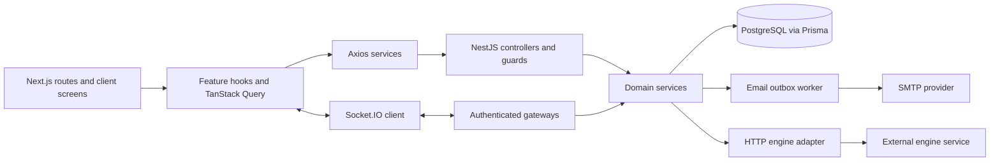
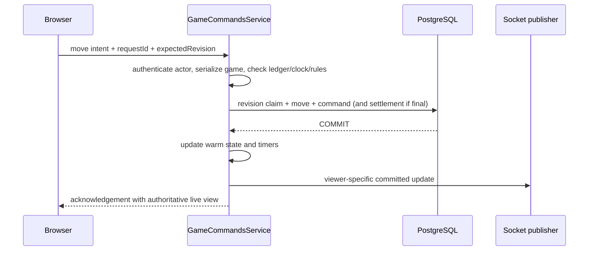

# Architecture

Current implementation audit: 29 October 2026. See [feature catalog](feature-catalog.md) for status, [testing](testing.md) for evidence and [deployment](deployment.md) for the single-backend constraint.

## Ownership

Next.js App Router pages/layouts compose screens, metadata and route parameters. Interactive screens are Client Components. There is no Next.js API/BFF or Server Action domain implementation. The browser uses the Nest API directly. Feature services own transport; queries/hooks coordinate server state; components render and retain only presentation state. Screens/providers compose cross-feature workflows instead of placing sibling-domain dependencies inside generic infrastructure.

NestJS owns identity, permissions, invitations, seat allocation, accepted chess moves, clocks, results, matchmaking and ratings. PostgreSQL owns durable truth. chess.js in the backend decides legality; frontend FEN helpers only render/provisionally preview server-authorized intent. `GameCommandsService` is shared by socket commands, HTTP fallback, timers and internal engine application. Browser clock interpolation, optimistic display and engine replies cannot make moves authoritative.

The external engine is accessed through HTTP/JSON. Its own service is expected to speak UCI internally; that service/executable is not in this repository. Nest does not spawn an engine process. SMTP is another external boundary; email is queued in domain transactions and sent later.

## State and consistency

| State | Owner and lifetime |
| --- | --- |
| Users, sessions, token digests, rooms, invites, inbox, outbox, moves, results, queue assignments, ratings/social | PostgreSQL; [data lifecycle](database.md) |
| Active reconstructed games, per-game serial lanes, timers | One Nest process; rebuilt at startup/read |
| Socket memberships, presence/disconnect grace, engine progress/search gate | One Nest process; ephemeral |
| Canonical browser room/game snapshots | TanStack Query; merged by identity/revision |
| Access token and session generation | Auth service memory; refresh token only HttpOnly cookie |
| Live-review cursor, flip, dialogs, pending moves | Local component/provider state |
| Manual variations | Mounted workspace state; explicit lifecycle cleanup; no persistence |
| Audio preferences / notification presentation claims | Browser localStorage; no credentials |

Domain transactions commit before responses acknowledge changes or publishers emit events. Game commits use revision-guarded updates; accepted move + resulting state + command ledger are atomic. Finalization includes both rating profiles and audit rows in the same transaction. Matchmaking/starts use a shared database admission advisory lock; social pairs use canonical pair locks, and room rows serialize seat claims. See [backend](backend.md) and [database](database.md).

Events are live hints/state updates, not a durable replay log. Snapshots and persisted inbox/search/rating reads recover missed delivery. Revisions reject late state; stable IDs deduplicate commands/notifications. Presence and engine progress have separate semantics and do not increment official game/room revisions. See [realtime](realtime.md).

## Major lifecycle boundaries

An engine search takes place outside the game serial lane and database transaction. A response re-enters the same command pipeline, which rechecks game/revision/turn/clock and legality. Resignation, timeout and newer revisions make late replies stale.

At startup the backend resets **every active game's** turn start to now and increments revisions while retaining last committed balances, then reconstructs/arms games and repairs engine turns. Downtime and uncommitted elapsed thinking are not charged. This deliberate policy makes simultaneous backend game owners unsafe even though some database admission races are tested across processes.

## Repository map and external dependencies

| Location | Role |
| --- | --- |
| `frontend/src/app`, `screens` | Route/layout entry points and composition |
| `frontend/src/features` | auth, audio, games, rooms, invitations, notifications, matchmaking, ratings, social, lobby |
| `frontend/src/lib`, `providers`, `config` | HTTP/query/realtime mechanics, composition, availability/routes |
| `frontend/src/mocks`, `frontend/public` | Explicit demo fixtures and assets |
| `backend/src/modules` | auth/users/health, rooms/invitations/notifications/mail/realtime, games/engines, matchmaking/ratings/social |
| `backend/src/common`, `config`, `database` | Guards, Zod pipe, errors/pagination, environment, Prisma/retry |
| `backend/prisma` | Schema and ordered migrations; no seed |
| `backend/openapi.json`, `backend/test` | Static contract and PostgreSQL/HTTP/socket integration suites |

Framework/library versions are pinned/resolved by each lockfile; declared versions and runtime commands are in each `package.json`. Principal declared dependencies: Next 16.4.2, React 19.3, TanStack Query 5, Axios 1, react-chessboard 5, Nest 12, Prisma 7, chess.js 1.4, Socket.IO 4, Zod 4, Argon2 and Nodemailer. Font build downloads use `next/font/google`; local fonts/assets do not remove that build dependency. No shared-package/workspace manager, worker broker, Redis adapter, deployed engine source, seed, CI workflow or production hosting manifest is checked in.
