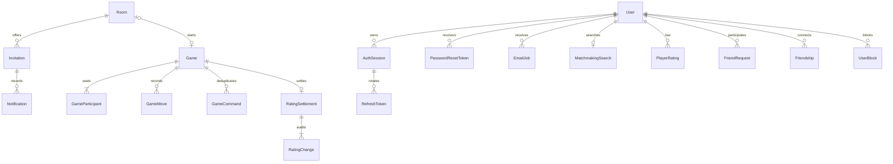

# Database and lifecycle

Canonical definitions: [Prisma schema](../backend/prisma/schema.prisma) and [ordered SQL migrations](../backend/prisma/migrations). Both matter: partial indexes, CHECKs and triggers cannot all be expressed in Prisma. Nineteen models are present. The PostgreSQL Prisma adapter uses a pool of10 connections and forces UTC on every connection; persisted times are mostly timestamptz(3). Application IDs are UUIDs, usually Prisma-generated; raw SQL callers must provide required values.

## Models and relationships

| Model | Identity / relations / role |
| --- | --- |
| User | UUID; unique normalized email and usernameKey; passwordHash, display username, created/updated timestamps, socialRevision; no emailVerified, avatar file, XP or consent record |
| AuthSession | UUID; user FK cascade; persistent/createdAt/lastUsedAt/expiresAt/revokedAt; many refresh tokens |
| RefreshToken | UUID; session FK cascade; unique SHA256 tokenHash, createdAt/usedAt; consumed digests retained for replay detection |
| PasswordResetToken | UUID; user cascade; unique digest, nullable encrypted mailPayload, expiry/consumed/revoked; linked outbox jobs |
| Room | UUID; host cascade, nullable challenger set-null; status/revision/settings/readiness/expiry; invitations and optional unique Game |
| Invitation | UUID; room/sender/recipient cascade; addressedBy, status/expiry/respondedAt; inbox/mail references |
| Notification | UUID; owner cascade, nullable actor set-null; type, optional invitation/room/friendRequest cascade; unique dedupeKey; readAt |
| EmailJob | UUID; recipient cascade, optional invitation/reset FK cascade; kind/dedupeKey, state/attempts/availableAt/lease, provider receipt/error/skip completion metadata |
| FriendRequest | UUID; sender/recipient cascade; canonical pairLow/pairHigh, pending/accepted/declined/cancelled state and timestamps |
| Friendship | UUID; canonical low/high user FKs cascade; one pair, createdAt |
| UserBlock | UUID; directional blocker/blocked FKs cascade; unique direction pair and timestamp |
| Game | UUID; unique nullable roomId set-null; FRIENDS/ENGINE/RANDOM, immutable creation/rating settings; active/finished, revision/ply/FEN/clocks/draw/result/PGN/end timestamps |
| GameParticipant | composite `(gameId,color)` PK, unique `(gameId,userId)`; game cascade, human user restrict; PLAYER or ENGINE, nullable user/name and immutable rating snapshots |
| GameMove | `(gameId,ply)` PK; game/participant seat cascade, actor user restrict/nullable for engine; requestId, UCI/SAN/captured/FEN/time/clock snapshot |
| GameCommand | `(gameId,actorId,requestId)` PK; game cascade, actor restrict; kind/fingerprint/applied revision; successful human command dedupe ledger |
| MatchmakingSearch | userId PK/FK cascade; one mutable row/account with new searchId, lifetime revision, string state/clock/rating/pair/ready/game assignment; game delete cascade |
| PlayerRating | `(userId,pool)` PK/user cascade; rating/peak/WDL/games/revision/leaderboardEligible |
| RatingSettlement | gameId PK/game cascade; immutable-policy calculation evidence, expected/actual score and rounded/applied delta |
| RatingChange | `(gameId,userId)` PK; settlement cascade, user/opponent restrict, participant composite FK cascade; pool/before/delta/after/score/time |

The diagram shows intended cardinalities; the database does not enforce an exact two-seat count through the Game FK alone. Services enforce complete seats, legal moves and domain eligibility.

## Constraints and indexes

| Area | Database enforcement | Application enforcement |
| --- | --- | --- |
| Identity | unique email/usernameKey; CHECK email=lower(trim(email)), username pattern, key=lower(username) | email format/max length, password policy/hash, consent checkbox |
| Room | distinct seats, positive revision, readiness requires challenger, READY requires both ready, closedAt consistency, broad clock bounds | exact preset list, host roles/limit, expected revision, allowed transitions/expiry |
| Invitation | not self, response timestamp iff accepted/declined, one pending per room/recipient partial unique | registered lookup, block policy, same-room lock/seat/expiry/actor rights |
| Inbox/mail | unique dedupe keys, unread partial index; attempts bounded, processing state tied to lock token | policy relevance/read counts, handler selection, provider validity checks |
| Game | revision/ply/clock bounds, ACTIVE iff running turn timestamp; finished iff result/reason/end timestamp; draw offers only active; result/termination consistency; engine failure only ENGINE+ABORTED; non-FRIENDS without Room | legal move history, participant/turn permissions, clock adjudication, exact two human/engine seat composition |
| Participant/move | unique seat/user, PLAYER requires user/no engineName or ENGINE requires name/no user, move seat FK, UCI regex/positive ply/nonnegative elapsed/clocks | actor matches seat, chess legality, consecutive accepted moves, repetition reconstruction |
| Queue | user PK, positive revision, state enum-like CHECK; pairId iff confirming, matched requires gameId; rated iff pool nonnull | one active game across starts/searches, compatible pair, expiry, readiness, window/block checks |
| Ratings | per-user/pool PK; floor/peak/nonnegative counters and WDL sum; unique settlement and player change; change arithmetic/score/distinct opponent; rated game settings/policy and snapshot CHECKs | exact pool mapping, eligible result, zero-sum calculation, both changes/completeness and snapshot consistency |
| Immutability | rating migration triggers protect Game mode/rated/pool/policy/clock/start creation settings and participant rating snapshots | accepted move/command ledgers are append-only through services; database does not generally forbid administrative UPDATE to every history table |
| Social | canonical ascending distinct pair CHECKs, FriendRequest pair derived from sender/recipient; one pending pair partial unique; unique friendship and directional block | actor/action rights, block policy, pair lock order, cooldown/hour cap, terminal request immutability |

Important indexes match access paths: session user/revoked and expiry; room host/status/challenger/status and status/expiry; invitation recipient/status/time, room/status and expiry; notification owner/createdAt/id descending plus unread partial; outbox status/availableAt; Game status and finished endedAt/id, mode/status; participant user/time; queue clock/state/queuedAt and pair; rating pool/eligibility/rating/user and private changes/time; social sender/recipient/state/time/id and prefix lookup through normalized username key. Cursor readers use composite timestamp/ID ordering rather than offset except the leaderboard.

## Transaction boundaries

- Accepted move: revision-claimed Game + GameMove + GameCommand in one SQL statement. Human retry dedupe is `(game,actor,requestId)` plus canonical fingerprint. Engine move uses game revision/ply rather than a fake-user ledger.
- Final result: the same state/move/command write plus settlement, both PlayerRating updates and two RatingChange rows inside one transaction. No result is exposed until commit returns; failure rolls everything back.
- Room start: shared admission → social pair → Room lock; checks confirmed revision/readiness, copies seats/settings, creates one game, cancels pending invites and marks STARTED together.
- Matchmaking: shared DB admission lock serializes eligibility, reservations, both readiness claims and one Game creation/assignment; searchId prevents old-tab cancellation. Database claims do not make in-memory game clocks safe across owners.
- Friend/request/block: canonical pair advisory locks with optional sender-rate/admission locks; changes plus social revisions and durable inbox effects commit together. Invitation create/accept uses the same pair policy; block cancels pending invitations in its transaction.
- Reset: locked User + conditional token consumption + password hash write + outstanding-token/all-session revocation + changed-password EmailJob in one transaction.
- Email: enqueue in owning transaction; provider calls outside it. SKIP LOCKED claim/lease token prevents stale worker completion, but SMTP side effect and SENT update cannot be one atomic transaction.

See [backend](backend.md) for operation flow and [security](security.md) for privacy boundaries. Database uniqueness/CHECKs do not replace application authorization.

## Migration sequence

| Migration directory | Effect |
| --- | --- |
| `202610220001_auth_foundation` | User, sessions/refresh tokens, identity constraints |
| `202610220002_rooms_invitations_notifications` | private rooms/invites/inbox/mail plus partial indexes/CHECKs |
| `202610260001_room_started_status` | STARTED enum added before dependent constraints |
| `202610260002_games` | authoritative games/participants/moves/commands and integrity rules |
| `202610260003_game_history` | finished history index |
| `202610260004_engine_enums` | engine mode/kind and aborted/failure enums |
| `202610260005_engine_games` | engine seats/nullable actors and adapted constraints |
| `202610280001_random_mode` | RANDOM mode |
| `202610280002_matchmaking` | durable searches/reservations/assignments |
| `202610280003_password_reset` | reset tokens and mail linkage |
| `202610280004_ratings` | pools/profiles/audit rows, snapshots and immutable-setting triggers; existing games remain casual |
| `202610290001_social` | requests/friendship/block, socialRevision, friend inbox types/linkage |

From `backend/`: `npm run prisma:generate`, `npm run db:validate`, `npm run db:migrate` (deploy committed migrations). `db:migrate:dev` is for creating developer migrations only, not production rollout. No seed is configured in Prisma/package scripts. Never collapse enum-add migrations into a transaction that uses a newly added enum before PostgreSQL commits it. Startup never migrates. [Deployment ordering](deployment.md#production-rollout).

## Retention and deletion

Room/invitation expiry persists terminal state, not deletion. Finished games, accepted moves, command ledgers, ratings, friend request history, notifications and mail receipts have no built-in retention purge. Active queue row is reused; its revision survives new searches. Friend requests have no TTL. Removing a friend deletes Friendship; block removes relationship and cancels pending records; unblock restores nothing. Neither operation removes committed game history/ratings or old inbox records.

Reset sweep clears expired sealed payload and deletes tokens whose expiresAt is over 7 days old; linked EmailJobs cascade. Settled/replaced/consumed payloads are cleared earlier. Sessions/used refresh digests need operator-managed maintenance after absolute expiry; retain consumed refresh digests through the session's lifetime. No scheduled session purge exists.

User deletion is not a product feature. Game participants/move actors/commands and rating player/opponent FKs restrict silently deleting accounts with history; other owned data cascades as specified above. There is no account erasure/anonymization workflow. Administrative database deletion, reset or migration rollback can destroy related history and must be treated as a separate reviewed operation. This documentation task did not execute any destructive SQL or migrations.
