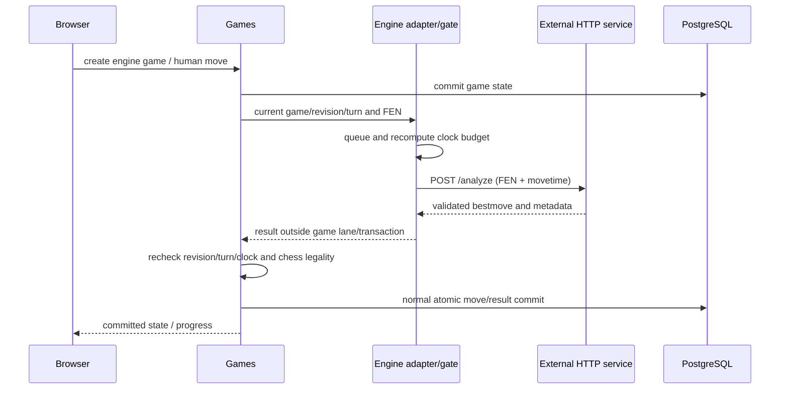

# Engine integration

The backend uses [HttpEngineAdapter](../backend/src/modules/engines/http/http-engine.adapter.ts), [EnginesService](../backend/src/modules/engines/engines.service.ts) and [EngineTurnService](../backend/src/modules/games/services/engine-turns.service.ts). The browser only calls Nest. The deployed/local engine service implementation, binary, UCI lifecycle and hosting configuration are **outside this repository**. The historical direct-UCI-process plan is superseded.

## Consumed service contract

`ENGINE_BASE_URL` unset means no provider and engine games disabled. It must be HTTP(S), without credentials/query/fragment; production requires HTTPS. Example configuration uses an operator-supplied placeholder; no public service is enabled merely by copying it. `EnginesService.requireReady` does a fresh health check before game creation; availability reads cache health for5 seconds and reserve nothing.

| External operation | Request | Runtime-validated reply |
| --- | --- | --- |
| GET `/health` | no auth or request body configured | `{status:string<=100,engine:string1–64,ready:boolean}` |
| POST `/analyze` | `{fen:<six-field FEN>,limits:{movetime:<integer ms>}}` for actual game turns | `success:true`, `bestmove:string\|null`, `ponder:string\|null`, `score:null\|{type:"cp"\|"mate",value:int}`, nonnegative integer `depth,nodes,nps,time_ms`, `pv:UCI[]` max 256, `timed_out:boolean` |

Coordinates match `^[a-h][1-8][a-h][1-8][qrbn]?$`. Only bestmove becomes intent; ponder/PV/score are validated, not applied/persisted/displayed as analysis. `timed_out:true` is treated as failed search, not an acceptable partial result. Null bestmove in a nonterminal position aborts rather than substituting a move. Legal replies with depth0/nodes0 are accepted but warned/count as unsearched. Adapter types support exactly one of movetime/depth/nodes within `engine.types.ts` ranges; game orchestration always selects movetime10–30000 ms.

The adapter has keep-alive HTTP/HTTPS agents, a64 KiB response cap, no redirects, explicit JSON parsing, AbortController deadline/cancellation and runtime Zod validation. No upstream authentication field is configured. Nested FastAPI `{detail:{error,...}}`, direct error bodies and validation-array bodies are recognized for bounded diagnostic descriptions. This audit verified the code contract and local tests only; it did not fetch an upstream OpenAPI or contact the deployed service. Internal UCI support is an external-service assumption recorded in the adapter comments/historical handoff, not locally verifiable binary behavior.

## Budgets, scheduling and stale replies

Default allowance200 ms. Per attempt compute `available=floor(remainingMs-transportReserveMs-commitReserveMs)`; search allowance is minimum(configured allowance,available,30000). Below10 ms no request is made; normal flag handling decides. HTTP deadline is min(configured request timeout,remaining minus commit reserve). Queue waiting and retries spend the running engine clock; budget recomputes after waiting/before each request. Transport reserve1500 ms and commit reserve150 ms are configured reserves, not measured current latency.

Global per-process search concurrency1, waiting capacity16 and active-engine-game admission4 by default. Admission count uses a DB advisory lock and rejects before creation; health alone does not reserve search capacity. Shared game admission prevents overlapping human/search/engine starts for the same account. One engine turn per game is keyed by game/revision; duplicate scheduling does nothing. Search runs outside transactions/serial lane, so resignation/other games can progress. Final application re-enters the lane, checks game active/same revision/engine color and official clock, validates with chess.js, then uses normal atomic persistence/broadcast.

Progress `queued|thinking|retrying` has revision/color/attempt/since and is ephemeral, not an official revision. Phase publications are chained. Refresh/reconnect/extra tabs read state and never start their own searches. A newer revision marks the old turn obsolete; returned legal-but-stale moves are discarded. Commit listeners, startup and default 5-second repair reschedule missing turns. During shutdown abort cancels searches without awarding results.

## Failure outcomes

| Failure | Normalized kind / behavior |
| --- | --- |
| HTTP 400/422 | invalid_position / invalid_request, no retry |
| HTTP 409 | busy, bounded retry |
| HTTP 502/503 or cannot connect | unavailable, bounded retry |
| connection breaks after sending | connection_lost, bounded retry with slot quarantine |
| HTTP 504 | upstream_timeout, no automatic retry |
| reply timed_out true | search_timed_out, no automatic retry |
| local HTTP deadline | deadline_exceeded, no ordinary retry; quarantine |
| malformed JSON/schema/move or other HTTP status | contract_violation, no retry |
| local full search queue | capacity_exhausted |
| caller cancellation | cancelled; no game abort on shutdown |
| clock cannot fit minimum request | no_time; clock timeout decides |

Retryable busy/unavailable/connection_lost attempts total 3 by default with exponential base300 ms, jitter0.5–1.0 multiplier and remaining-clock bound. Requests that may still run upstream (deadline/connection_lost/cancel) retain the slot for requested search duration + default 2000 ms quarantine. This is bounded local protection, not proof the remote search stopped.

An unsavable returned move retries application after 100/500/1500 ms; ambiguous prior commits reload/republish rather than apply twice. Exhaustion releases the turn for periodic repair. Exhausted upstream/nonclock failure aborts ENGINE with ABORTED/ENGINE_FAILURE (no win/draw/rating). If the official clock has expired by application/abort, ordinary timeout result takes precedence. No random fallback move is inserted.

Engine seats are `kind=ENGINE,userId=null,engineName=<reported at creation>`; no fake User. GameMove.actorId null identifies engine move; deterministic turn request IDs plus revision/ply guard duplicate application. Finished and aborted games remain in own history/replay. Sending only current FEN to the external service does not carry earlier repetition history; the backend retains full history for adjudication. Engine analysis scores/PV are not saved, difficulty/Elo are not exposed and no review/evaluation job exists.

## Timing and verification

Keep these distinct: requested movetime (budget), service-reported time_ms (metadata), measured adapter HTTP roundTripMs (network/service overhead), gate queueMs, game receive→queue→validate→DB commit→emit timings, and full player-to-player/render latency. `EngineMetrics` holds5000 bounded samples; `GameMetrics`20000. Neither has a public monitoring endpoint. Fixture delays/printed test timings are not deployed performance measurements. Historical milestone benchmarks remain historical; no live smoke/load/latency measurement was performed here.

Configuration defaults/ranges are in [deployment](deployment.md#engine-environment). Tests: adapter spec, engines service spec, engine-budget spec, engine-turns spec and `backend/test/engine-games.e2e-spec.ts` (local HTTP double). `engine-live.e2e-spec.ts` is separately gated and calls a real service, so it was not run. See [testing](testing.md).
